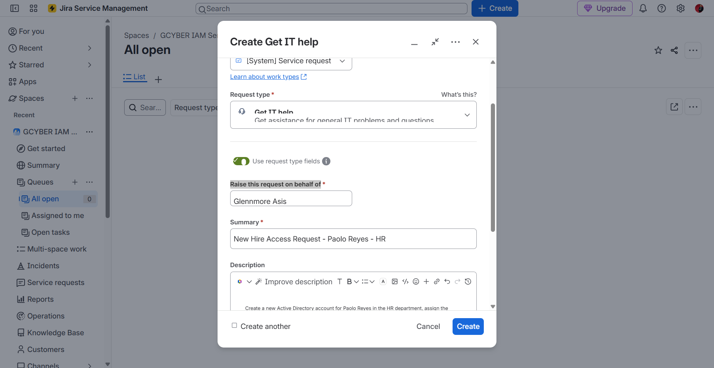
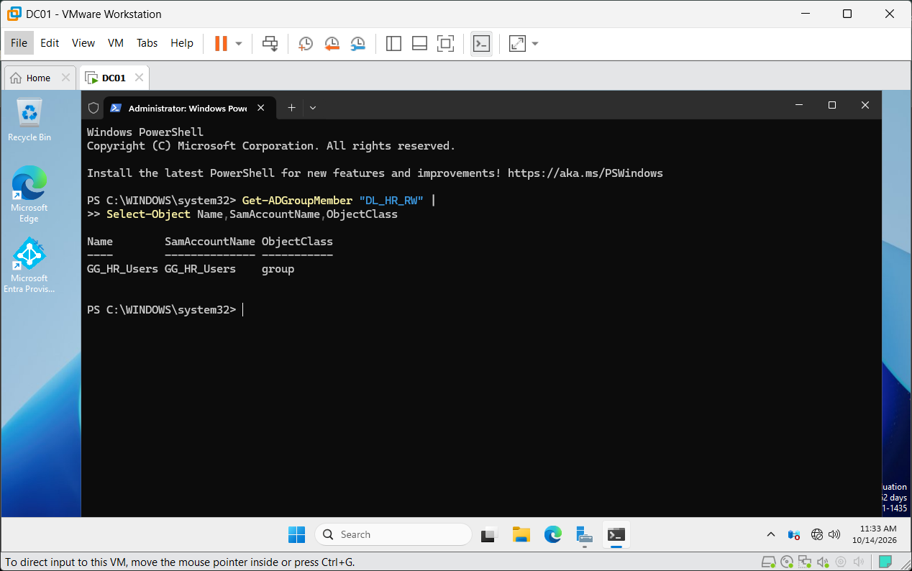
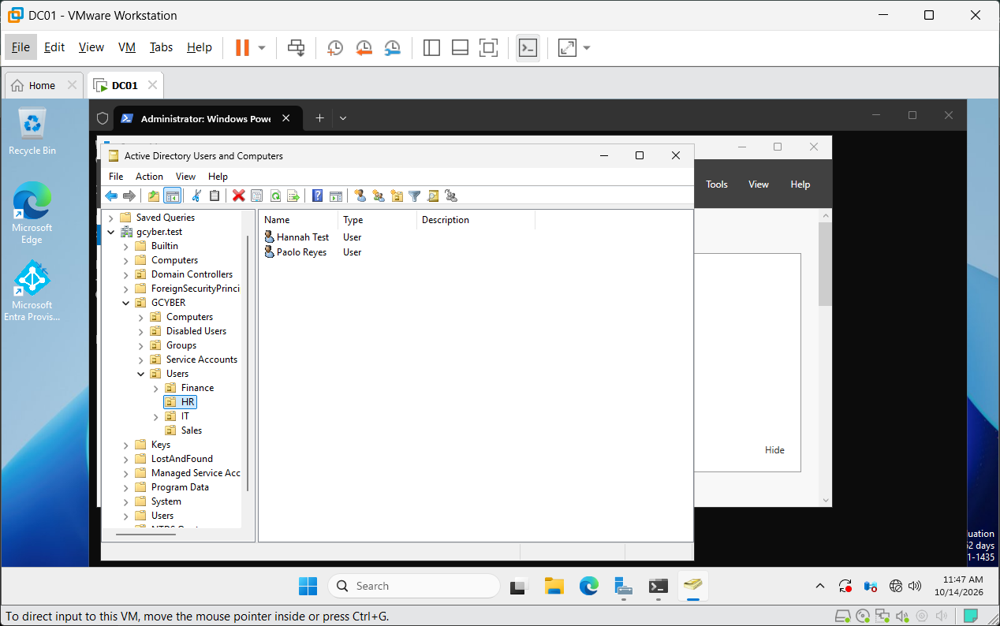
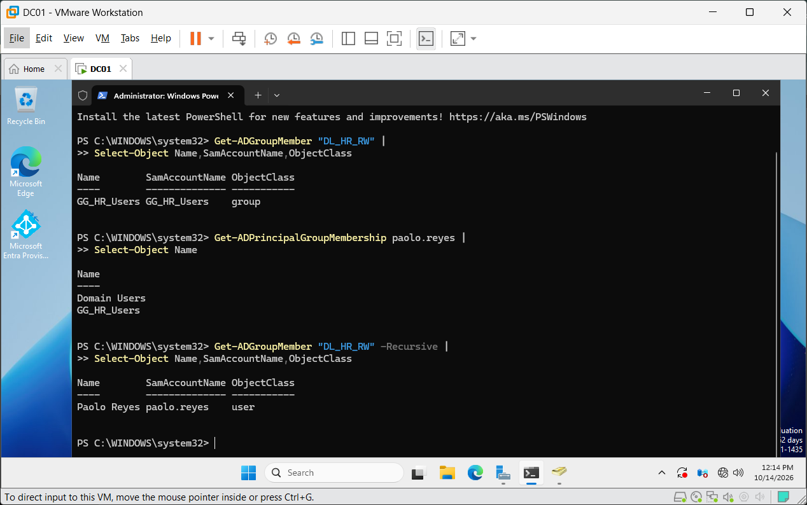
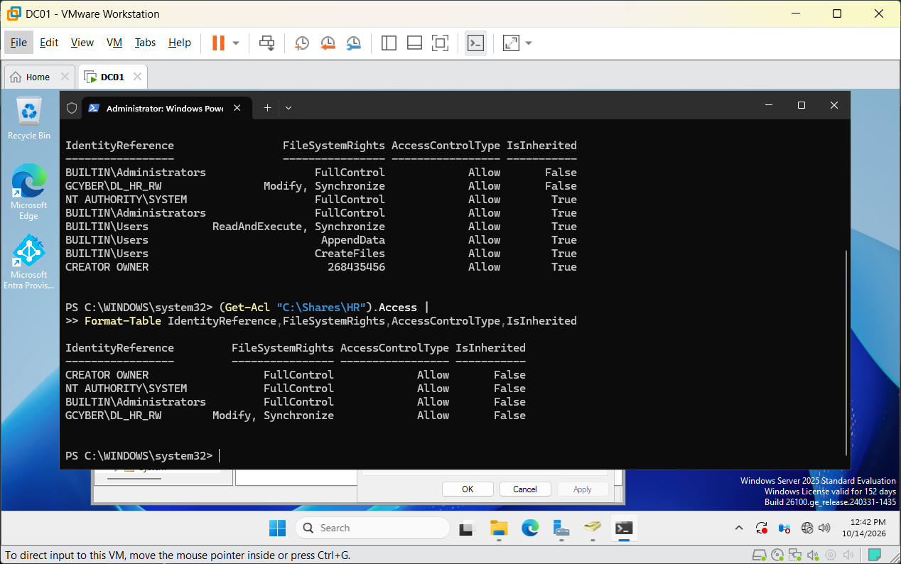
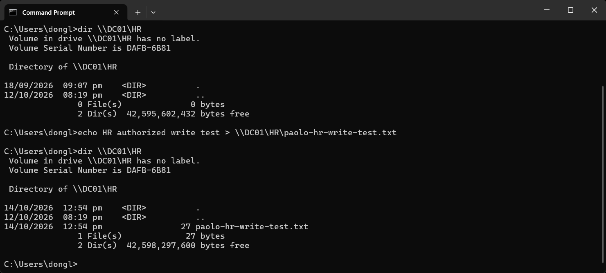
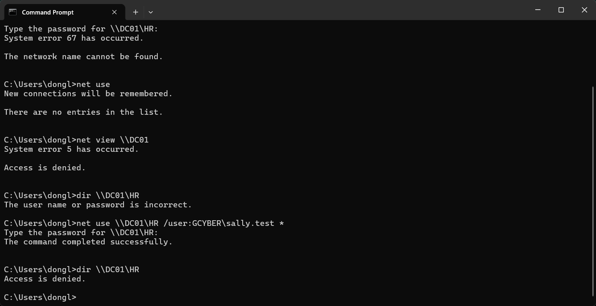
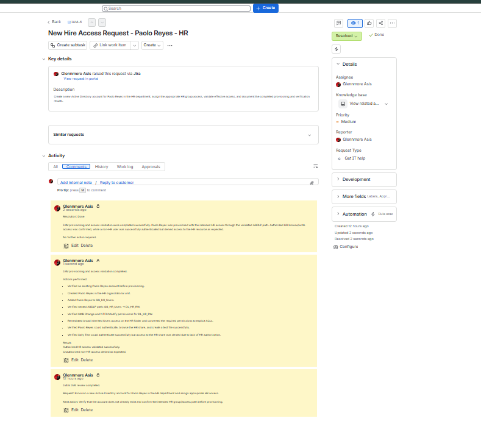

## Evidence Gallery

### Evidence 01 — Jira Joiner Request Created

**What this proves:**  
The IAM service request for Paolo Reyes was formally created in Jira Service Management, establishing the business request and ticket context for the joiner workflow.

---

### Evidence 02 — HR AGDLP Group Nesting Verified

**What this proves:**  
The HR Global Security Group is correctly nested inside the Domain Local resource-access group.

**Validated path:**

`GG_HR_Users → DL_HR_RW`

This confirms the intended AGDLP authorization structure before assigning the new user.

---

### Evidence 03 — Paolo Reyes AD Account Created in HR OU

**What this proves:**  
The new Active Directory identity for Paolo Reyes was successfully created inside the HR organizational unit.

This confirms the joiner identity was provisioned in the intended administrative location.

---

### Evidence 04 — Recursive HR Entitlement Verified

**What this proves:**  
PowerShell recursively resolves Paolo Reyes as an effective member of the HR Domain Local resource group.

**Effective authorization path:**

`Paolo Reyes → GG_HR_Users → DL_HR_RW`

This validates the nested group entitlement rather than relying only on direct membership.

---

### Evidence 05 — Final Explicit NTFS ACL Verified with PowerShell

**What this proves:**  
The HR folder ACL was cleaned and revalidated after broad inherited Users access was removed.

The intended business access principal remains:

`GCYBER\DL_HR_RW → Modify`

The screenshot also confirms the final ACL was explicitly configured and independently verified through PowerShell.

---

### Evidence 06 — Authorized HR Write Access Verified

**What this proves:**  
Paolo Reyes successfully accessed the HR SMB share and created a test file.

The presence of:

`paolo-hr-write-test.txt`

provides functional proof that the intended HR user received effective browse/write access through the configured AGDLP, SMB, and NTFS permission chain.

---

### Evidence 07 — Unauthorized HR Access Denied After Successful Authentication

**What this proves:**  
Sally Test successfully authenticated using valid domain credentials, but access to the HR share was denied because the account did not have the required HR entitlement.

This demonstrates the difference between:

**Authentication:** Success  
**Authorization:** Access Denied

This is the negative access-control validation for the lab.

---

### Evidence 08 — Jira Ticket Resolved and Closed

**What this proves:**  
The full IAM workflow was documented and formally completed in Jira Service Management.

Final ticket state:

**Status:** Resolved  
**Resolution:** Done

This provides the final ITSM audit trail for the provisioning and access-validation workflow.

